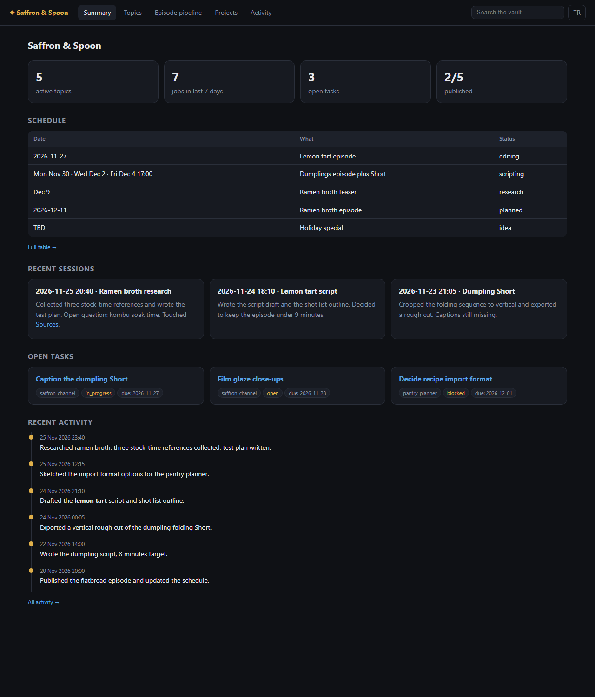

# vault-dashboard

A local, read-only web dashboard for any folder of Markdown notes (Obsidian or plain).

Your notes already say what you are working on: an "active topics" file, a last-session
note, one file per task, a log of what happened, a schedule table, project folders. This
reads those files and shows them as one page, so you can see the state of everything
without opening ten notes.

- **Summary**: counts, upcoming schedule rows (today and later only), recent sessions,
  open tasks, recent activity
- **Topics**: active, waiting and closed topics with their "Next:" line
- **Pipeline**: one row per item folder, one column per stage, done when the stage's file exists
- **Projects**: project folders with note count, event count and last activity
- **Activity**: the event log day by day, with a project filter
- **Note viewer** with clickable `[[wikilinks]]`, and **search** across the vault
- English and Turkish UI, with a toggle on the page



Python 3.11+, standard library only. It never writes to your vault.

## Install

```bash
pip install git+https://github.com/siborgafro/vault-dashboard
```

or clone the repo and run `pip install -e .`

## Use

Try the demo (a fictional cooking channel):

```bash
vault-dashboard --vault example-vault
```

then open http://127.0.0.1:8767. On your own vault:

```bash
vault-dashboard --vault ~/notes --config ~/notes/dashboard.toml
python -m vault_dashboard --vault ~/notes --port 8767
```

Options: `--vault PATH` (required), `--config FILE`, `--host` (default `127.0.0.1`),
`--port` (default `8767`), `--open` (open the browser). Without `--config`, the file
`<vault>/dashboard.toml` is used if it exists, otherwise the defaults.

With no config at all, only the sources that exist at their default locations show up
(`Threads.md`, `Last-Session.md`, `tasks/`, `receipts/`, `projects/`). Everything else is
hidden, not broken. Search and the note viewer always work.

## Configuration

Copy [`config.example.toml`](config.example.toml) and edit. Every key is optional and paths
are relative to the vault. A working example is in
[`example-vault/dashboard.toml`](example-vault/dashboard.toml).

| Section | Keys | What it feeds |
|---|---|---|
| `[dashboard]` | `title`, `language` (`en`/`tr`), `host`, `port` | page title, UI language, listen address |
| `[threads]` | `file`, `active_headings`, `closed_headings`, `waiting_keywords`, `next_markers` | Topics tab, topic count |
| `[sessions]` | `file`, `limit` | recent sessions (`## heading` blocks, newest first) |
| `[tasks]` | `folder`, `done_statuses` | open tasks (front matter: `title`, `status`, `project`, `due`) |
| `[receipts]` | `folder`, `time_key`, `refs_key`, `limit` | Activity tab, recent activity, weekly count |
| `[schedule]` | `file`, `heading`, `limit` | upcoming rows from the first table under `heading` |
| `[pipeline]` | `root`, `title`, `published_keywords`, `published_url_regex`, `published_sources` | Pipeline tab |
| `[pipeline.stages]` | `Stage name = "File.md"` or a list, `*` wildcards allowed | pipeline columns |
| `[projects]` | `folder` | Projects tab, project filter |
| `[search]` | `exclude`, `max_results` | vault search |

Formats:

- **Topics file**: bullets like `- **Title:** text, a date 2026-01-31, Next: what comes next [[Note]]`
  under a heading containing "Active", and bullets under "Closed".
- **Events (receipts)**: one `.md` per event; front matter (JSON, or `key: value` lines) has
  `created_at` (ISO timestamp) and `refs` (list of note paths); the body is the summary.
  A ref like `projects/blog/Post.md` attributes the event to the project `blog`.
- **Tasks**: one `.md` per task, front matter as above. Statuses in `done_statuses` are hidden.
- **Schedule dates** are read from the first column: ISO dates, `Nov 30`, `30 Nov`, ranges
  like `Mon Nov 30 · Fri Dec 4` (the last date counts), Turkish month names too. Rows with no
  parseable date are kept.
- **Published**: an item counts as published when a line in the scanned files names its
  folder (a leading number like `03-` may be left out) together with one of
  `published_keywords` or a match of `published_url_regex`.

The demo's dates are fixed (late 2026), so the schedule fills up as that date range ages
out; edit `example-vault/projects/saffron-channel/Schedule.md` to refresh it.

## Privacy and safety

- Listens on `127.0.0.1` only by default. It shows your notes, so don't expose it to a
  network you don't trust (the CLI warns if you bind elsewhere). Requests with a foreign
  `Host` header are refused while bound to localhost (DNS-rebinding guard).
- Strictly read-only: only GET and HEAD are served. The note viewer resolves every path,
  refuses anything outside the vault (including `..` and symlinks that leave it), refuses
  dot-folders such as `.git` and `.obsidian`, and serves `.md` files only.
- No telemetry, no network calls, no scripts in the page. The language choice is stored in
  one cookie on your machine.

## Türkçe

vault-dashboard, bir Markdown ya da Obsidian kasasındaki dosyaları okuyup yerel bir web
sayfasında gösterir: aktif konular, son oturumlar, açık görevler, yayın takvimi (yalnız
bugün ve sonrası), iş hattı (klasör başına aşama dosyaları), projeler, gün gün akış, not
görüntüleyici (`[[wikilink]]` tıklanır) ve kasada arama. Kasaya hiçbir şey yazmaz, yalnız
`127.0.0.1` üzerinde açılır, ek paket gerekmez (Python 3.11+).

Kurulum: `pip install git+https://github.com/siborgafro/vault-dashboard`. Deneme:
`vault-dashboard --vault example-vault`. Kendi kasanız için `dashboard.toml` yazın
(`config.example.toml`'a bakın); dosyası olmayan bölümler gizlenir. Arayüz dili
`language = "tr"` ile ya da sayfadaki EN/TR düğmesiyle değişir.

## License

MIT
